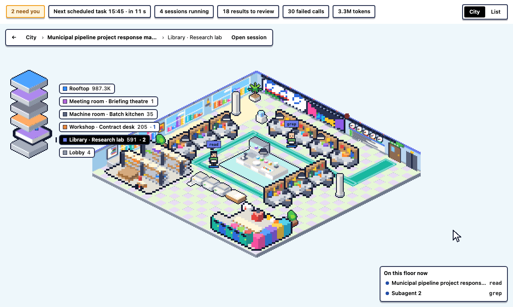
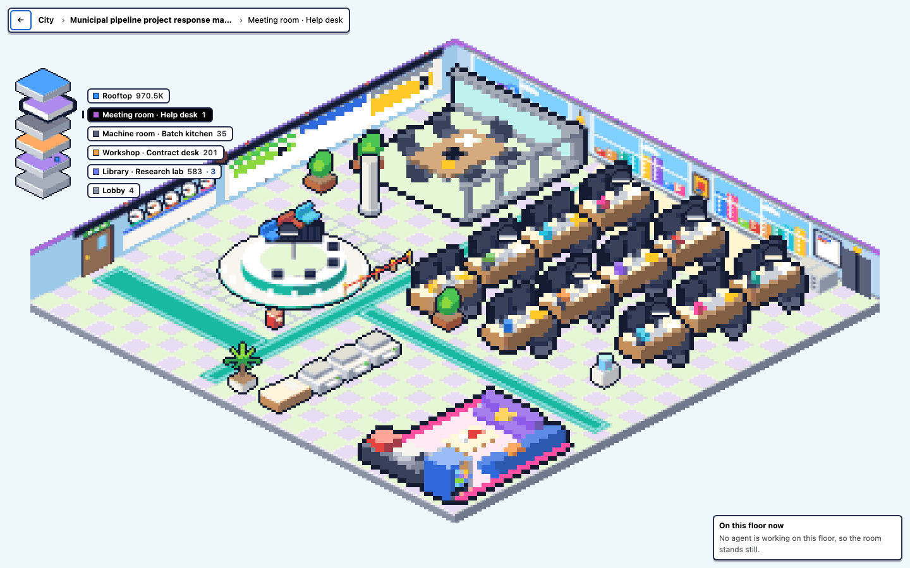

# DSH Universe

**The all-in-one, real-time agent monitor for DeepSeek Harness.** AI agent data visualization that turns every
session and task across all your DSH workspaces into a live, interactive pixel city: sessions are buildings, agents
are people.


One glance tells you what is running, what is waiting on you, what failed, where the tokens went and what is
scheduled next. Errors, token use, call volume, schedules and finished work each have their own view, and one click
takes you to the session in DSH. It reads metadata only, on your own device.

All screenshots and animations use a made-up sample day (`fixtures/dsh-sample.ts`). No real sessions or data.

## Features

**Real-time overview**
- Every session and agent across all workspaces, live, in one city.
- The **Today** bar counts what needs you, the next scheduled task, what is running, results to review, failed calls
  and token use. Press one to jump to it; `n` goes to the next thing waiting for you.
- A **list view** with the same content as text.

**Needs you**
- Agents waiting for an approval, an answer or a plan to read gather in Review Square holding a sign.
- They stand out more the longer they wait.
- One click follows the agent; **Open session** takes you to it in DSH.

**Errors**
- Fire layer: a fire on each building with failed calls, bigger for more failures; recent ones burn, older ones
  smoulder, and fire engines drive out to them.
- Error Recovery counts today's retried model requests and keeps a repair log.

**Token and model use**
- Power-grid layer: one Model Hub per model with its load, and a wire to each building from the model it used most.
- A meter beside each building shows its token use today; the top three get a bolt overhead.

**Call volume**
- Traffic layer: roads turn yellow, orange and red with the calls of the last 5 minutes, and cars stand for calls.

**Schedules**
- Scheduled runs arrive as trains at the Scheduler.
- A clock over the Scheduler points at the next scheduled task; each building's clock shows when it started.

**To review**
- Sessions that finished and you have not looked at, sessions with an unsent draft, and delivered files are marked on
  their roofs until you open them or mark them as seen.

**Inside each session**



- Each session is a building that grows with its work.
- Click it to go inside: real rooms themed by the session title, with floor size following the building's size.
- Agents and subagents sit at their desks, posed by the kind of tool they are using.
- Data props you can click: the call tape, call log board, error beacon and job printers.

**Timeline**
- Look back at any minute of today, or replay the whole day.
- Totals for each of the last 14 days.

**Workspace-aware**
- Each workspace is its own district with a sign; buildings keep their place from day to day.

**Day and night**
- Auto (follows the DSH theme), day or night. At night only places that are working or waiting are lit.

**Accessible**
- Full keyboard control and a screen-reader list view.
- Respects reduced motion.
- Light and dark themes; English and Chinese interface.

**Fast**
- Built for 60 fps frames and checked with 100 buildings; it still draws with no GPU (software rendering).

**Private by design**
- Metadata only: never your messages, replies, tool arguments or results, or file contents.
- Nothing leaves your device.

## Gallery

| | |
| --- | --- |
|  |  |
| **Night.** Only the places with a session in progress are lit. | **Errors.** One kind of data at a time; the rest of the city is greyed out. Token use and call volume work the same way. |
|  |  |
| **Review Square.** Agents that need you (an approval, a question, a plan to read) wait in Review Square with a sign. | **Timeline.** Drag back to any moment of the day, or replay it. |
|  |  |
| **Inside a building.** One floor for each kind of work, with the agents standing where they work. | Each kind of floor has its own room, and rooms are laid out like the real thing. |
|  | |
| **List.** Everything in the city as text, for screen readers and small screens. | |

## Install

Needs DeepSeek Harness **0.2.2-rc.2 or newer**.

1. Open **Plugins** and click **Add plugin**.
2. Enter `@khglobal/dsh-universe` and click **Install**.
3. When it says **Installed**, click **Enable now**.

**DSH Universe** then appears in the sidebar. No restart is needed.

Command line, for advanced users:

```sh
dsh plugin --profile web add @khglobal/dsh-universe
```

Use the name of your profile in place of `web`, and restart DSH after installing from the command line.

## What it reads

Metadata only, on your own device:

- times, tool names, the kind of each call, token counts and whether a call failed;
- session and workspace titles (the ones DSH already shows in its lists), model names, connector names and status,
  your installed plugins and skills, and scheduled-task names and times.

It **never** reads your messages, the model's replies or thinking, tool arguments or results, file contents, error
text or file paths. Subagents are shown by their preset name, not their prompt.

## Privacy

- Nothing is uploaded. The plugin makes no network requests of its own; the panel talks only to your own DSH.
- Nothing is put into any prompt, and it adds no tools for the model.
- The day's summary is kept in DSH's storage on this device for 14 days. Each device has its own city; nothing is
  synced.

## Development

Node 24.21 or newer.

```sh
npm ci
npm run dev        # the panel on the sample day at http://127.0.0.1:5174/ (?lang=en, ?theme=dark)
npm run check      # typecheck, build, tests, locale checks, npm tarball audit
```

The README animations are recorded from the real panel on the sample day with a fixed clock, so they come out the
same every time: `CHROME_PATH=<chrome-headless-shell> node scripts/readme-gifs.mjs` (needs FFmpeg; gifsicle is used
when it is installed).

How the packages fit together: [docs/ARCHITECTURE.md](docs/ARCHITECTURE.md). User guide:
[docs/USER-GUIDE.en.md](docs/USER-GUIDE.en.md).

## Security

See [SECURITY.md](SECURITY.md).

## Licence

**Source-available, not open source.** You may read the code, and install and use the unmodified plugin with DeepSeek
Harness. Copying, modifying, redistributing or reusing the code or the art (including the procedural art and
templates) in other works needs KH's written permission. Copyright KH. See [LICENSE](LICENSE).
