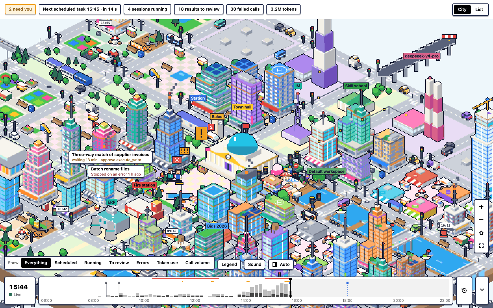
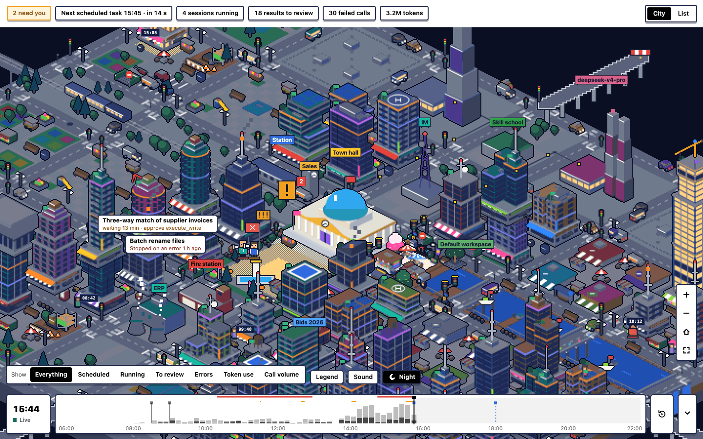
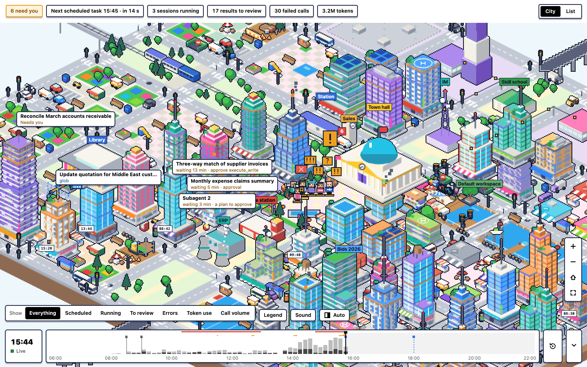
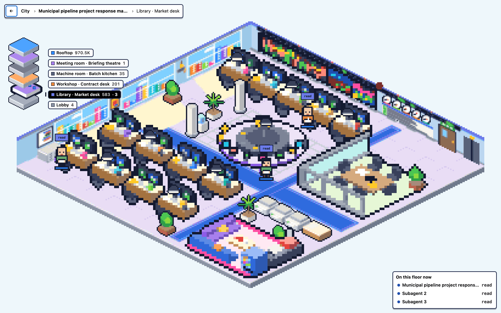

# DSH Universe

Your DeepSeek Harness day as a small pixel city. Every session is a building and every agent is a person, so one look
tells you what is running, what is waiting for you and what got done today.



All screenshots use a made-up sample day (`fixtures/dsh-sample.ts`). No real sessions or data.

## Gallery

| | |
| --- | --- |
|  |  |
| **Night.** Only the places with a session in progress are lit. | **Errors.** One kind of data at a time; the rest of the city is greyed out. Token use and call volume work the same way. |
|  |  |
| **The square.** Agents that need you (an approval, a question, a plan to read) wait in the city square with a sign. | **Timeline.** Drag back to any moment of the day, or replay it. |
|  |  |
| **Inside a building.** One floor for each kind of work, with the agents standing where they work. | Each kind of floor has its own room, and rooms are laid out like the real thing. |
|  | |
| **List.** Everything in the city as text, for screen readers and small screens. | |

## Features

- **The city.** A building for each session that grows as the session works. Subagents work on the floors of their
  session's building.
- **Today.** A row along the top: what needs you, the next scheduled task, what is running, results to review, failed
  calls and token use. Press one to go to it.
- **Show.** Scheduled, Running, To review, Errors, Token use or Call volume: one kind at a time.
- **Inside a building.** One floor for each kind of work (library, workshop, machine room, meeting room, lobby and
  rooftop), with the agents on the floor where they are working now.
- **Timeline and replay.** Look back at any minute of today, or replay the whole day.
- **Day and night.** Follows the DSH theme, or choose day or night.
- **Open session.** Point at a building and press **Open session** to go to that session in DSH.
- **List view.** The same content as text, keyboard and screen-reader friendly.

## Install

Needs DeepSeek Harness **0.2.2-rc.2 or newer**.

1. Open **Plugins** and click **Add plugin**.
2. Enter `@khglobal/dsh-universe` and click **Install**.
3. When it says **Installed**, click **Enable now**.

**DSH Universe** then appears in the sidebar. No restart is needed.

Command line, for advanced users:

```sh
dsh plugin --profile web add @khglobal/dsh-universe
```

Use the name of your profile in place of `web`, and restart DSH after installing from the command line.

## What it reads

Metadata only, on your own device:

- times, tool names, the kind of each call, token counts and whether a call failed;
- session and workspace titles (the ones DSH already shows in its lists), model names, connector names and status,
  your installed plugins and skills, and scheduled-task names and times.

It **never** reads your messages, the model's replies or thinking, tool arguments or results, file contents, error
text or file paths. Subagents are shown by their preset name, not their prompt.

## Privacy

- Nothing is uploaded. The plugin makes no network requests of its own; the panel talks only to your own DSH.
- Nothing is put into any prompt, and it adds no tools for the model.
- The day's summary is kept in DSH's storage on this device for 14 days. Each device has its own city; nothing is
  synced.

## Development

Node 24.21 or newer.

```sh
npm ci
npm run dev        # the panel on the sample day at http://127.0.0.1:5174/ (?lang=en, ?theme=dark)
npm run check      # typecheck, build, tests, locale checks, npm tarball audit
```

How the packages fit together: [docs/ARCHITECTURE.md](docs/ARCHITECTURE.md). User guide:
[docs/USER-GUIDE.en.md](docs/USER-GUIDE.en.md).

## Security

See [SECURITY.md](SECURITY.md).

## Licence

**Source-available, not open source.** You may read the code, and install and use the unmodified plugin with DeepSeek
Harness. Copying, modifying, redistributing or reusing the code or the art (including the procedural art and
templates) in other works needs KH's written permission. Copyright KH. See [LICENSE](LICENSE).
