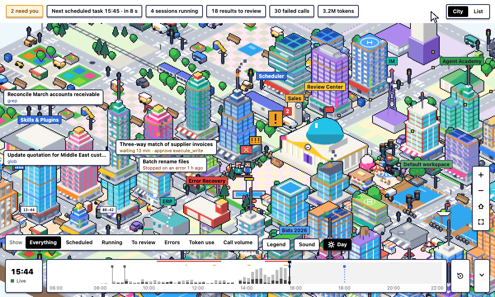
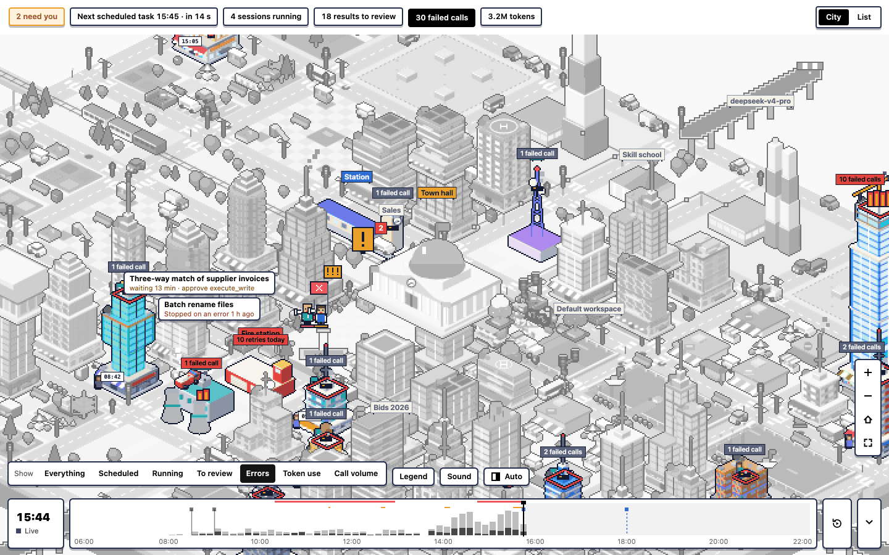
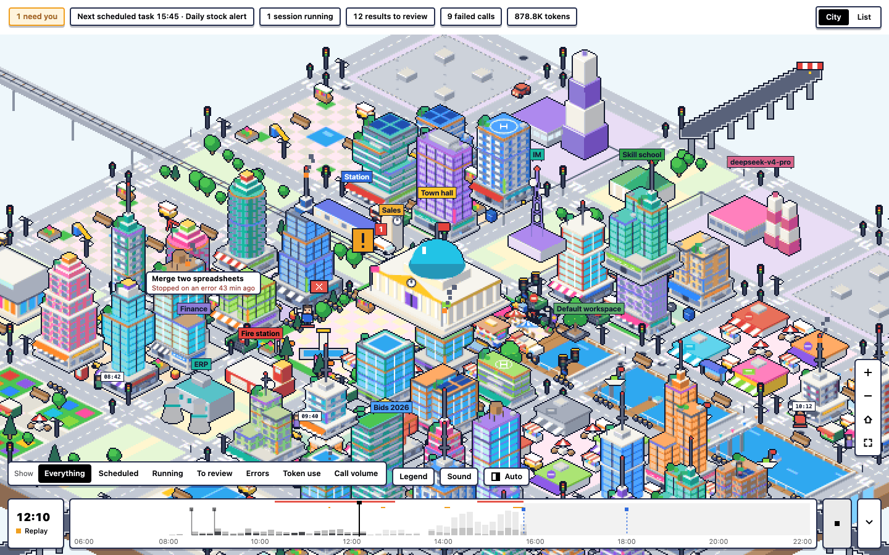
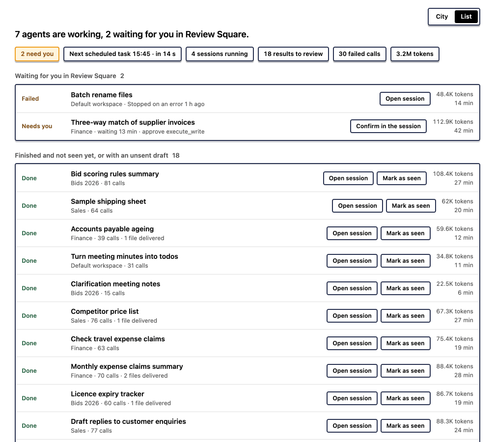

# DSH Universe

**The all-in-one, real-time agent monitor for DeepSeek Harness.** AI agent data visualization that turns every
session and task across all your DSH workspaces into a live, interactive pixel city: sessions are buildings, agents
are people.



One glance tells you what is running, what is waiting on you, what failed, where the tokens went and what is
scheduled next. Errors, token use, call volume, schedules and finished work each have their own view, and one click
takes you to the session in DSH. It reads metadata only, on your own device.

All screenshots and animations use a made-up sample day (`fixtures/dsh-sample.ts`). No real sessions or data.

## Features

**Real-time overview**
- Every session and agent across all workspaces, live, in one city.
- The **Today** bar counts what needs you, the next scheduled task, what is running, results to review, failed calls
  and token use. Press one to jump to it; `n` goes to the next thing waiting for you.
- A **list view** with the same content as text.

**Needs you**
- Agents waiting for an approval, an answer or a plan to read gather in Review Square holding a sign.
- They stand out more the longer they wait.
- One click follows the agent; **Open session** takes you to it in DSH.

**Errors**
- Fire layer: a fire on each building with failed calls, bigger for more failures; recent ones burn, older ones
  smoulder, and fire engines drive out to them.
- Error Recovery counts today's retried model requests and keeps a repair log.

**Token and model use**
- Power-grid layer: one Model Hub per model with its load, and a wire to each building from the model it used most.
- A meter beside each building shows its token use today; the top three get a bolt overhead.

**Call volume**
- Traffic layer: roads turn yellow, orange and red with the calls of the last 5 minutes, and cars stand for calls.

**Schedules**
- Scheduled runs arrive as trains at the Scheduler.
- A clock over the Scheduler points at the next scheduled task; each building's clock shows when it started.

**To review**
- Sessions that finished and you have not looked at, sessions with an unsent draft, and delivered files are marked on
  their roofs until you open them or mark them as seen.

**Inside each session**


- Each session is a building that grows with its work.
- Click it to go inside: real rooms themed by the session title, with floor size following the building's size.
- Agents and subagents sit at their desks, posed by the kind of tool they are using.
- Data props you can click: the call tape, call log board, error beacon and job printers.

**Timeline**
- Look back at any minute of today, or replay the whole day.
- Totals for each of the last 14 days.

**Workspace-aware**
- Each workspace is its own district with a sign; buildings keep their place from day to day.

**Works with Claude, ChatGPT (Codex) and WorkBuddy**
- Inside DSH: work a session delegates to Claude Code or Codex (DSH's official `dsh-subagent-claude-code` and
  `dsh-subagent-codex` plugins) shows up as an agent in that session's building, in the engine's own colours and named
  "Claude Code" or "Codex", with its status and whether it failed. Its task and its answer are never read.
- Neighbouring cities, one per vendor, automatic: when another agent tool is on the same device, its sessions appear as
  a city next to the DSH one, with no setup, including sessions started outside DSH; new sessions show up live.
  - **Claude**: Claude Code sessions and the Claude desktop app's agent sessions (Cowork, and sessions started in its
    Code tab). Each session's card says which product it is from ("Claude Code" or "Claude app"), its people wear that
    product's colours, and Cowork has a district of its own.
  - **ChatGPT**: Codex sessions (the ChatGPT desktop app's agent work goes into the same Codex store).
  - **WorkBuddy**: WorkBuddy's (Tencent's desktop AI agent) sessions.

  The DSH city stays the default view: a small chip such as "Claude · 3 running" shows each neighbour, and one click
  goes there. Zoom out past the whole city to see the cities side by side, each with its sign; go into one for the
  same buildings, rooms and data views (errors, token use, call volume, waits). Under **Nearby cities** each source has
  its own switch, grouped by city, and that choice is remembered. Silent where none is installed, as in a cloud
  workspace.
- The Today bar's running, failed-call and token figures add those local sessions, labelled "+n local", with the
  breakdown by city (DSH, Claude, ChatGPT, WorkBuddy) on hover. Runs DSH delegates to Claude Code or Codex keep no
  session of their own in those tools' stores, and a session the Claude app's Code tab runs is counted once, so nothing
  is counted twice.
- On the Astero workbench home, the **Today** tile (`@khglobal/dsh-universe#today`; 4×2, 2×2 or 4×1) shows the still
  mini city with what needs you, what is running, failed calls, tokens and the next scheduled task. Running, failed
  calls and tokens carry the same "+n local" part; the tile asks for those figures only while it is on screen, about
  once every 45 seconds. A click opens the city.

**Sound** (off by default)
- Each city has its own ambience, driven by its own activity: a murmur while sessions run, soft ticks for calls, a
  falling sign while calls fail, two low notes while someone waits. Only the city in view plays, and moving to another
  city crossfades; zoomed out to all cities, they play quietly together and the city you point at comes forward.
  Nothing plays before your first click, while looking back, or with reduced motion.

**Day and night**
- Auto (follows the DSH theme), day or night. At night only places that are working or waiting are lit.

**Accessible**
- Full keyboard control and a screen-reader list view.
- Respects reduced motion.
- Light and dark themes; English and Chinese interface.

**Fast**
- Built for 60 fps frames and checked with 100 buildings; it still draws with no GPU (software rendering).
- Light on the battery: it paints only what moves, slows down when you leave it alone, almost stops in a background
  window and stops when hidden (a few percent of one core on a 300-session day).

**Private by design**
- Metadata only: never your messages, replies, tool arguments or results, or file contents.
- Nothing leaves your device.
- The Claude, ChatGPT and WorkBuddy cities are shown automatically when those tools are on your device, and read only
  what is listed under [What it reads](#what-it-reads). Turn any source off under **Nearby cities**.

## Gallery

| | |
| --- | --- |
|  |  |
| **Night.** Only the places with a session in progress are lit. | **Errors.** One kind of data at a time; the rest of the city is greyed out. Token use and call volume work the same way. |
|  |  |
| **Review Square.** Agents that need you (an approval, a question, a plan to read) wait in Review Square with a sign. | **Timeline.** Drag back to any moment of the day, or replay it. |
|  |  |
| **Inside a building.** One floor for each kind of work, with the agents standing where they work. | Each kind of floor has its own room, and rooms are laid out like the real thing. |
|  | |
| **List.** Everything in the city as text, for screen readers and small screens. | |

## Install

Needs DeepSeek Harness **0.2.2-rc.2 or newer**.

1. Open **Plugins** and click **Add plugin**.
2. Enter `@khglobal/dsh-universe` and click **Install**.
3. When it says **Installed**, click **Enable now**.

**DSH Universe** then appears in the sidebar. No restart is needed.

Command line, for advanced users:

```sh
dsh plugin --profile web add @khglobal/dsh-universe
```

Use the name of your profile in place of `web`, and restart DSH after installing from the command line.

## What it reads

Metadata only, on your own device:

- times, tool names, the kind of each call, token counts and whether a call failed;
- session and workspace titles (the ones DSH already shows in its lists), model names, connector names and status,
  your installed plugins and skills, and scheduled-task names and times.

It **never** reads your messages, the model's replies or thinking, tool arguments or results, file contents, error
text or file paths. Subagents are shown by their preset name, not their prompt.

**Runs delegated to Claude Code or Codex inside DSH:** that a run started and ended, its engine, whether it failed,
and the delegating call's tool name and time. DSH reports no tool calls or token use for these runs, so none are
shown. The task description and the run's answer are never read.

**Neighbouring cities** (shown automatically when the tool is on this device, until you turn that source off), from
the agent session files on this device, and nothing else:

| Source (city) | Files read |
| --- | --- |
| Claude Code (Claude) | `~/.claude/projects/<project>/<session>.jsonl` and its subagents' files |
| Claude app (Claude) | Cowork: `<app>/local-agent-mode-sessions/<account>/<org>/local_<id>/.claude/projects/**.jsonl`; Code tab: of `<app>/claude-code-sessions/<account>/<org>/local_<id>.json` only `cliSessionId` and `fromCliTranscript`, then that session's file in `~/.claude/projects`. `<app>` is `~/Library/Application Support/Claude` (macOS) or `%APPDATA%\Claude` (Windows) |
| Codex (ChatGPT) | `~/.codex/sessions`, `~/.codex/archived_sessions` |
| WorkBuddy (WorkBuddy) | `~/.workbuddy/projects/<project>/<session>.jsonl` and its subagents' files |

- read: session ids, times, the project folder's name (the full path never leaves the plugin's host side, and only
  as a hash), model names, token counts, tool names and counts, whether a call failed (an error flag, an exit code,
  whether an error field is there), turns starting and ending, retried requests, subagents and their preset names;
- a session's title only when you set one yourself (Claude Code's `/rename`); otherwise sessions are named by project
  folder and date (Cowork sessions are in a "Cowork" district);
- **never**: messages, prompts, the model's replies or reasoning, tool input or output, commands, patches, file
  contents, error text, generated titles or summaries, your prompt history, account ids, e-mail addresses or links;
  the Claude app's session metadata files beyond the two keys above (they hold the first message, the system prompt
  and the account's e-mail), its audit log, uploads and outputs; chats with Claude or ChatGPT (kept in the vendor's
  cloud, not on this device); any app's browser storage (Local Storage, IndexedDB, caches), cookies, token, sign-in
  or settings files; WorkBuddy's database, tasks, traces, memory, logs and settings; Codex's state databases.

Not supported, and why: plain claude.ai and ChatGPT chats are not on this device (only in the vendor's cloud and the
apps' private browser caches, which are never read). The ChatGPT desktop app keeps no agent-session records of its own:
its Codex work is in the Codex store, read as above. A title you give a WorkBuddy session is kept only in WorkBuddy's
database, which is not read, so WorkBuddy sessions are named by folder and date. The separate CodeBuddy editor
extension keeps only sign-in data on this device and is not read.

Large stores are read incrementally (only what was added since the last look, from today's first line, at most 14
days back), in small steps that never hold up DSH: the DSH city is ready first and the neighbours fill in after. What
was read (file hashes, read positions and the metadata above, never a path or any content) is kept in DSH's storage
on this device, so the next start reads only what changed.

## Privacy

- **Local agent sessions are shown automatically.** If Claude Code, the Claude desktop app, Codex or WorkBuddy is on
  this device, its session metadata (the fields under [What it reads](#what-it-reads), never messages, prompts or tool
  content) is shown in the Claude, ChatGPT or WorkBuddy city and counted in the Today bar, with no click. Each source
  is on by default. To turn one off, open **Nearby cities** (top right of the panel) and clear its switch: reading
  stops, what was read is dropped, and the choice is remembered on this device (a choice made in 0.2 for Claude Code
  or Codex carries over). In a cloud workspace there are no such stores, so nothing is shown.
- Nothing is uploaded. The plugin makes no network requests of its own; the panel talks only to your own DSH.
- Nothing is put into any prompt, and it adds no tools for the model.
- The day's summary is kept in DSH's storage on this device for 14 days. Each device has its own city; nothing is
  synced.

## Development

Node 24.21 or newer.

```sh
npm ci
npm run dev        # the panel on the sample day at http://127.0.0.1:5174/ (?lang=en, ?theme=dark)
npm run check      # typecheck, build, tests, locale checks, npm tarball audit
```

The README animations are recorded from the real panel on the sample day with a fixed clock, so they come out the
same every time: `CHROME_PATH=<chrome-headless-shell> node scripts/readme-gifs.mjs` (needs FFmpeg; gifsicle is used
when it is installed).

How the packages fit together: [docs/ARCHITECTURE.md](docs/ARCHITECTURE.md). User guide:
[docs/USER-GUIDE.en.md](docs/USER-GUIDE.en.md).

## Security

See [SECURITY.md](SECURITY.md).

## Licence

**Source-available, not open source.** You may read the code, and install and use the unmodified plugin with DeepSeek
Harness. Copying, modifying, redistributing or reusing the code or the art (including the procedural art and
templates) in other works needs KH's written permission. Copyright KH. See [LICENSE](LICENSE).
