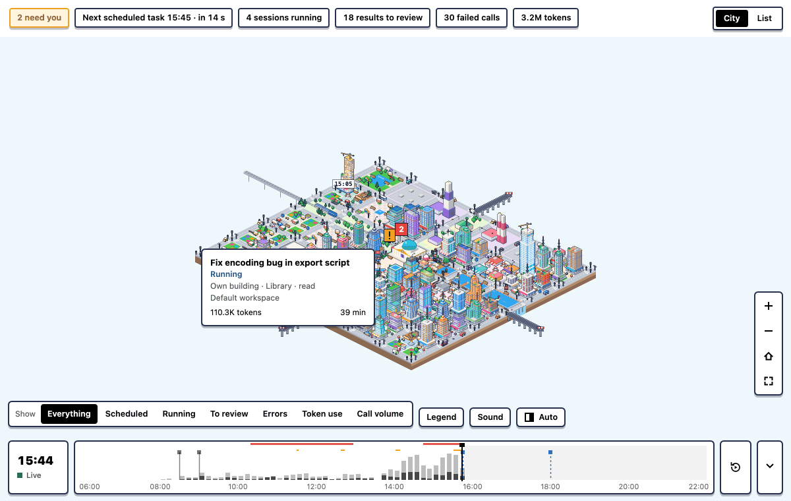
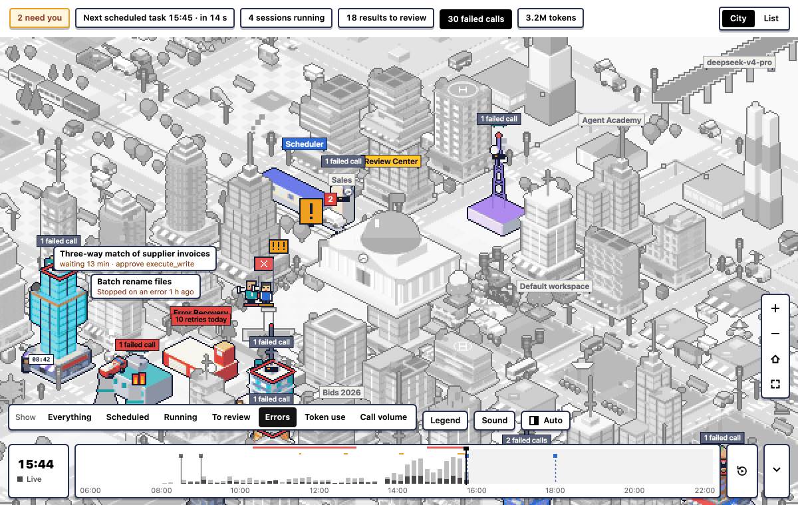
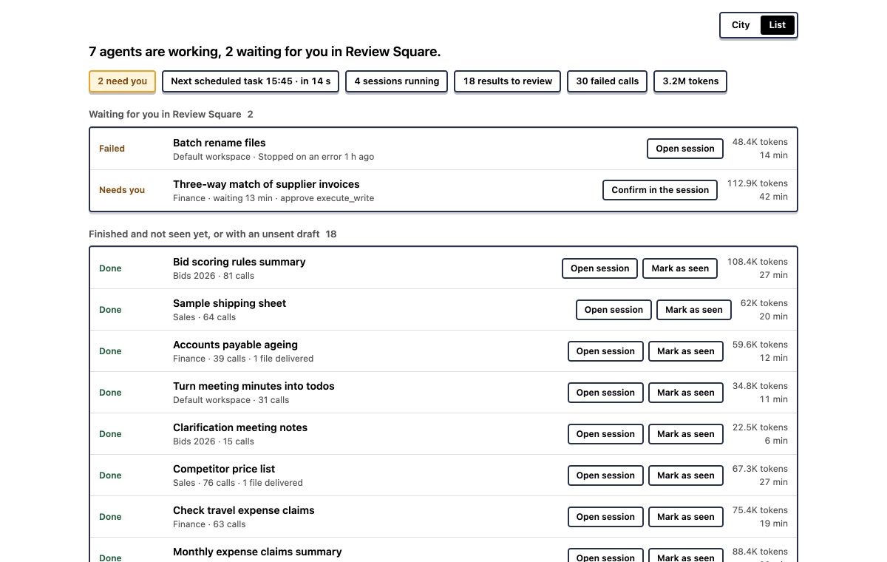
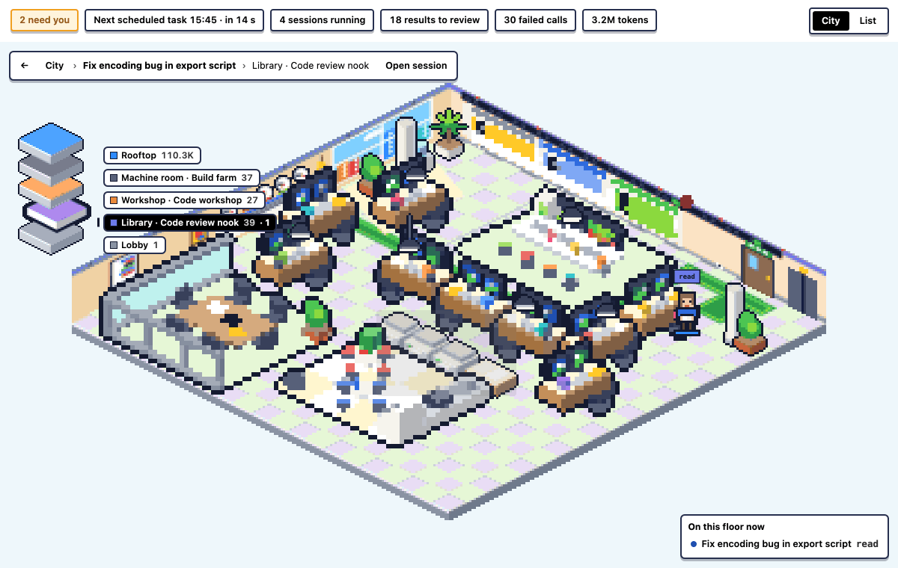

# DSH Universe: member guide

DSH Universe draws your DSH day as a small pixel city. Every session you start puts up a building, every agent is a
person, and every tool call shows up as traffic, light and work. Open it from **DSH Universe** in the DSH sidebar.

## What the city shows

| In the city | In DSH |
| --- | --- |
| A building | One session. It grows a section for each kind of work it does (reading, editing, running commands, connectors…), with a band in that kind's colour on top. |
| A person | An agent. The colour under their feet is the state: Running, Needs you, Idle, Done or Failed. Subagents work inside their parent's building. |
| A sign held up in Review Square | That agent is waiting for you (an approval, a question, or a plan to read). |
| Cars on the avenues | Calls made in the last five minutes. |
| Lit windows at night | Only places that are working or waiting stay lit. An idle city stands still. |

The AI facilities stand round Review Square: the **Review Center** (approvals, questions and plans), the **Scheduler**
(scheduled tasks), **Error Recovery** (errors and retries), the **Agent Academy** (skill loads and experts), **Skills &
Plugins** (what you installed) and one **Model Hub** per model. Each MCP server has its own **MCP Gateway**, and
installed plugins line **Plugin Row**. Workspaces are
districts, each with a sign showing the workspace's name.

Point at a building to see its card: what the session is doing, its calls, token use and time. **Open session**
on the card takes you to the session in DSH; clicking the building takes you inside. Open **Legend** for a one-page key. The first time you open
DSH Universe a four-step tour points these out; **Show the tour again** in the legend repeats it.

## Review Square and the data views

Review Square in front of the Review Center is where agents wait for you. The first button of the Today row along the top shows how many
things need you, and the `n` key jumps to the next one. The row is ordered by urgency: waiting for you, scheduled,
running, to review, errors, tokens; a press switches to that layer and goes to the next item.

The **Show** buttons pick one question at a time and grey out everything else:

- **Scheduled**: sessions that scheduled tasks started today, and when the next one runs.
- **Running**: what is working right now.
- **To review**: finished sessions you have not opened yet.
- **Errors**: failed calls and sessions that stopped on an error.
- **Token use**: where today's tokens went.
- **Call volume**: which sessions and connectors are busiest.

**List** shows the same content as text, grouped by what needs you. It is the best view for screen readers and
small screens.

## The timeline and replay

The timeline along the bottom covers today. Drag it, or use the arrow keys (one minute per press), to look back at
any moment: the city rebuilds itself as it stood then. `W` jumps to the next wait and `Shift+W` to the previous one.
**Replay today** plays the whole day forward; **Back to live** returns to now. You can minimise the timeline to a
thin bar.

## Going inside a building

Click a building, or choose **Go inside** on its card (with the keyboard, `Enter` opens the place in the middle of the view). A building opens
floor by floor; each kind of work has its own room, furnished from that session's real numbers: calls today, the
last error, what is on the shelves. Agents stand where they are working. Hover or tap a person or a piece of
furniture for a short card. Use **Floors** to change floor (the lift carries you between them) and **Back to the
city** or `Esc` to leave.

The AI facilities can be entered too: Skills & Plugins shows what you installed, the Agent Academy your skills and
experts, the Scheduler the day's scheduled tasks.

## Claude Code and Codex

**Inside DSH.** When a session hands work to Claude Code or Codex (with DSH's Claude Code or Codex subagent plugins),
the run appears in that session's building as a person in the engine's colours (Claude Code: a terracotta jacket and
a cream cap; Codex: a dark hoodie with a teal visor), named "Claude Code" or "Codex". You see whether it is still
working, finished or failed. DSH does not report these runs' tool calls or token use, so their card says so.

**Neighbouring cities.** If Claude Code or Codex is installed on the same computer, a small hint asks whether to show
its sessions as a city next to the DSH one. **Show its city** turns it on, **Not now** leaves it off; either way the
choice is remembered, and **Nearby cities** (top right) has a switch for each. With one on, zoom out past the whole
city (the `−` button or key, or the **All cities** button) to see the cities side by side, each with its sign; choose
one to go in. Each city has the same buildings, rooms and data views; views with nothing to show (schedules) are left
out. A Claude Code session is titled with the name you gave it (`/rename`); other sessions by project folder and
date. Nothing is read until you turn a city on, and nothing leaves your computer. In a cloud workspace there are no
such tools, and nothing is shown.

## What it reads, and what it never reads

DSH Universe reads **metadata only**, on your own device:

- times, tool names, the kind of each call, token counts and whether a call failed;
- session and workspace titles (the same ones DSH shows in its own lists), model names, connector names and their
  status, the plugins and skills you installed, scheduled-task names and times.

It **never** reads your messages, the model's replies or thinking, tool arguments or results, file contents, error
text or file paths. A subagent's title is its prompt, so subagents are shown by their preset name or as "Subagent n".
Nothing is uploaded and nothing is put into any prompt. The day's summary is kept in DSH's own storage on this
device and deleted after 14 days.

## One city per device

Each device builds its own city. Where a building stands, which results you have seen, and your view settings
(legend, timeline, city or list) are stored on that device and not synced. Your desktop and a cloud environment
each have their own city, and the same session may stand on a different plot in each.

## Accessibility

Everything in the city is also in the list view. In the city, the arrow keys pan, `+` and `−` zoom, `0` returns to
Review Square, `Enter` opens the place in the middle and `Esc` goes back. With reduced motion turned on in your system,
the city updates at most twice a second and nothing flashes.
